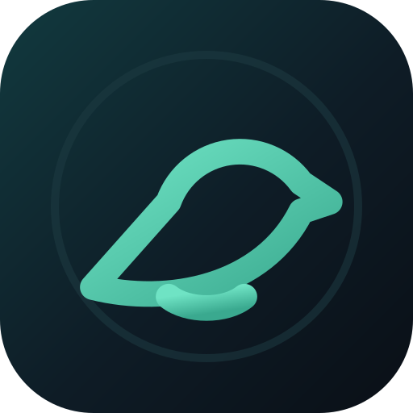
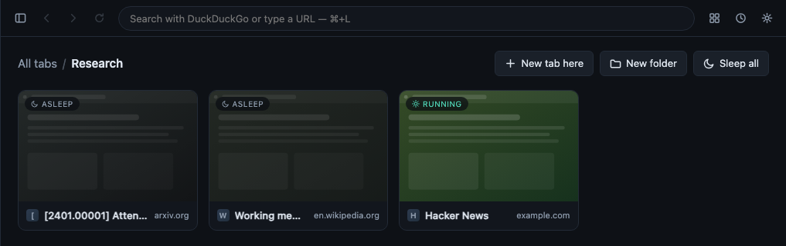

<div align="center">
  

# Raha

**A calm browser where you decide which tabs get your memory and CPU.**

Raha is a free desktop browser for macOS, Windows and Linux. Tabs over the limit sleep: their process is closed and the memory goes back to the computer. Each keeps its place, title and history, and loads again on a click.



[](../../actions/workflows/ci.yml)
[](LICENSE)

Current version: 0.3.3 (11 November 2026). [Download](https://magronox.github.io/raha-browser/#download) · [Known issues](https://magronox.github.io/raha-browser/details.html#status) · [Version 1.0, in development](https://magronox.github.io/raha-browser/#v1)
</div>

## What it does

- **Set the number.** Six tabs run by default. Past that, the tab used least recently sleeps. A pinned tab stays awake, and so does a tab playing sound.
- **See the cost.** A bar at the bottom lists each running tab with its memory and CPU. A site can be given its own limit: with 800 MB for `*.slack.com`, a Slack tab over that sleeps.
- **Quiet by default.** No account, no telemetry. Blocks known ads and trackers, from lists shipped with the app.
- **Folders.** Folders nest inside folders, show as a grid of thumbnails, and take tabs by drag and drop. After a restart the whole tree comes back, asleep.

Raha can also freeze a tab: it stops running but keeps its page exactly as it was. It has a command palette (⌘K or Ctrl+K), a downloads panel, local history, and a preview of a sleeping tab that does not wake it.

The website has the rest:

- [How tabs are put to sleep](https://magronox.github.io/raha-browser/details.html#governor): the five rules, in order. The code is [`src/shared/policy.js`](src/shared/policy.js).
- [Privacy](https://magronox.github.io/raha-browser/details.html#privacy): every request Raha makes on its own, and each default.
- [Status of 0.3.3](https://magronox.github.io/raha-browser/details.html#status): known issues and what is planned for each.

## Coming in 1.0

Version 1.0 is in development. Built so far: split view, Today (todos and a calendar), Journeys (a notebook that also checks chosen pages for changes), a new design in light and dark themes, and third-party cookies blocked by default. The [website](https://magronox.github.io/raha-browser/#v1) has the list. Plans can change before release. 1.0 has no fixed date; it comes out when its tests pass. It will be free to use.

To hear when it comes out: **Watch → Custom → Releases** on this repository, or the [releases feed](https://github.com/Magronox/raha-browser/releases.atom).

## Install

This repository holds the 0.3.3 code.

Download from **[Releases](../../releases)** or the [website](https://magronox.github.io/raha-browser/). GitHub shows a SHA-256 checksum next to each file.

- **macOS 13 or later**: a dmg, for Apple Silicon or Intel. It is not signed with a developer certificate, so macOS asks you to confirm the first launch. On macOS 14 and earlier, right-click the app and choose Open, then Open. On macOS 15 and later, try to open it once, then open System Settings → Privacy & Security and click Open Anyway.
- **Windows**: an installer. It is not signed, so SmartScreen asks once (*More info → Run anyway*).
- **Linux**: AppImage or deb.

The first launch opens a one-minute tour (`raha://welcome`). The [User Guide](docs/USER_GUIDE.md) covers every setting, rule recipes, shortcuts and troubleshooting.

To run the code from source (Node 22 or later):

```bash
git clone https://github.com/Magronox/raha-browser
cd raha-browser
npm install
npm start
```

There is no build step: the code in `src/` is the code that runs ([ADR-0003](docs/DECISIONS/ADR-0003-no-build-step.md)).

## Keyboard shortcuts

| | macOS | Windows and Linux |
|---|---|---|
| New tab / close tab | ⌘T / ⌘W | Ctrl+T / Ctrl+W |
| Reopen closed tab | ⇧⌘T | Ctrl+Shift+T |
| Go to address | ⌘L | Ctrl+L |
| Find in page | ⌘F | Ctrl+F |
| Command palette | ⌘K | Ctrl+K |
| Grid / home | ⌘E | Ctrl+E |
| Sidebar | ⇧⌘B | Ctrl+Shift+B |
| Downloads | ⌘J | Ctrl+J |
| Sleep this tab / sleep every tab | ⇧⌘S / ⇧⌘A | Ctrl+Shift+S / Ctrl+Shift+A |
| Freeze this tab | ⇧⌘F | Ctrl+Shift+F |
| Pin (keep running) | ⇧⌘K | Ctrl+Shift+K |
| Next running tab / jump to one | Ctrl+Tab / ⌘1…9 | Ctrl+Tab / Ctrl+1…9 |
| Back / forward | ⌘[ / ⌘] | Alt+← / Alt+→ |
| History | ⌘Y | Ctrl+H |
| Settings | ⌘, | Ctrl+, |

## What changed in 0.3.3

0.3.3 replaces 0.3.1 and earlier. It fixes the two problems in the [security advisory for 0.3.1](https://github.com/Magronox/raha-browser/security/advisories/GHSA-m68f-fgxg-6v72). The website has a [summary of the changes](https://magronox.github.io/raha-browser/details.html#changed); the [CHANGELOG](CHANGELOG.md) lists every one.

## Security

[SECURITY.md](SECURITY.md) says how to report a problem and lists the risks that were accepted, such as tab thumbnails stored unencrypted on disk. The July 2026 check against Electron's security checklist is in [docs/SECURITY-AUDIT-2026-07.md](docs/SECURITY-AUDIT-2026-07.md).

## Bugs and ideas

Bugs and ideas go to [Issues](https://github.com/Magronox/raha-browser/issues). Issues are public; security problems go through the [private form](https://github.com/Magronox/raha-browser/security/advisories/new).

## How it was built

Raha is written with AI coding assistants, mainly Claude by Anthropic, which wrote most of the code and documentation. Amir Basareh decides what goes in, tests each release and is responsible for it. Automated tests and written rules are there to catch mistakes before a release.

## Working on the code

The code is laid out so a person or an AI agent can change it safely. The logic is separate from Electron and tested on its own, one file lists every message between the window and the engine, and tests enforce the rules.

- People: start with [CONTRIBUTING.md](CONTRIBUTING.md).
- AI agents: start with [CLAUDE.md](CLAUDE.md), which works for any agent. Step-by-step playbooks are in [docs/PLAYBOOKS/](docs/PLAYBOOKS/).
- Decisions are recorded in [ADRs](docs/DECISIONS/); the rules that must not break are in [INVARIANTS.md](docs/INVARIANTS.md).

```bash
npm run verify   # types, lint, unit tests, UI harness and end-to-end tests: the definition of done
```

## Licence

The code in this repository (versions up to 0.3.3) is open source under [GPL-3.0-only](LICENSE), © 2026 Amir Basareh. Anyone who distributes a changed version must offer its source under the same licence. The **Raha** name and bird mark are reserved ([TRADEMARK.md](TRADEMARK.md)). Why this combination: [ADR-0002](docs/DECISIONS/ADR-0002-gpl3-plus-trademark.md). The licence terms of version 1.0 will be published with it.

Raha includes Electron (MIT) and Chromium (BSD-style and other licences), Ghostery's ad-block engine (MPL-2.0), and the EasyList and EasyPrivacy lists by the EasyList authors (GPL-3.0 or CC BY-SA 3.0). The 0.3.3 packages carry these licences in `LICENSE`, `THIRD_PARTY_NOTICES.txt`, `LICENSE.electron.txt` and `LICENSES.chromium.html`.
